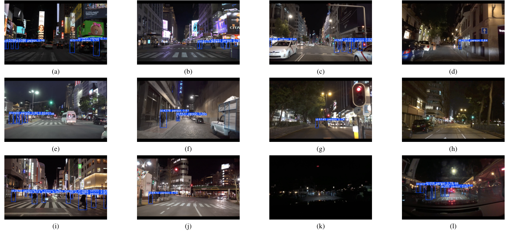
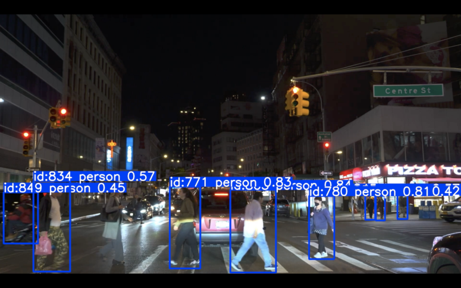

# NightSteps

### A Night-Time Dataset and Benchmark for Pedestrian Crossing Intention Prediction

NightSteps is a dataset for pedestrian crossing intention prediction at night. It includes dashcam footage from six cities worldwide, annotated pedestrian locations, track IDs, and crossing behaviour labels to support the evaluation of autonomous driving systems in low-light conditions. Full-length source videos are available separately through the original links listed below.



*Examples from Figure 7 of the paper. Left to right: New York City and Madrid (top row), Buenos Aires and Hong Kong (middle row), Tokyo and Amsterdam (bottom row).*

This repository is the central project page for NightSteps, providing documentation, source-video links, and the results reported in the accompanying paper.

## Download

The NightSteps dataset is available on Zenodo:
[Download the dataset](https://doi.org/10.5281/zenodo.23674077)

## Overview

Predicting whether a pedestrian is about to cross the road is important for safe autonomous driving. However, widely used PCIP datasets predominantly contain daytime footage. NightSteps addresses this gap through a benchmark based on urban driving footage recorded at night.

The footage captures a range of challenging situations, including:

- Poorly illuminated pedestrians and strong contrasts between light and dark areas.
- Bright billboards, shop windows, and street lighting.
- Partial obstruction by vehicles, street furniture, or other pedestrians.
- Crowded crossings, small groups, and individual pedestrians.
- Different street layouts and both left-hand and right-hand traffic.

## Geographic Coverage and Collection

| City | Footage source | Recording year |
|---|---|---|
| Amsterdam | Recorded for this study | 2026 |
| Buenos Aires | J Utah, YouTube | 2020 |
| Hong Kong | J Utah, YouTube | 2020 |
| Madrid | J Utah, YouTube | 2021 |
| New York City | J Utah, YouTube | 2023 |
| Tokyo | J Utah, YouTube | 2023 |

The Amsterdam footage was recorded using an Insta360 X5 camera mounted at the front of a car, using its front-facing lens. Additional dashcam recordings from the other five cities were selected to broaden the range of environments and pedestrian behaviour.

Segments containing visible pedestrians were selected from the original recordings. For the experiments described in the paper, the selected footage was standardised to MP4 format, a resolution of **1920 × 1080 pixels**, a **16:9 aspect ratio**, and **30 frames per second**.

### Original Video Sources

The following five recordings were published by **J Utah**. Follow each link to access the original recording. 

- [Buenos Aires — Buenos Aires 4K - Night Drive - Driving Downtown](https://www.youtube.com/watch?v=75X9vSFCh14)
- [Hong Kong — Hong Kong 4K - Night Drive - Driving Downtown](https://www.youtube.com/watch?v=XaR6qEt-BIY)
- [Madrid — Driving Downtown - Madrid 4K - Night Drive](https://www.youtube.com/watch?v=6CadnBQGLdE)
- [New York City — Driving New York City 4K HDR - Midtown Manhattan Lights](https://www.youtube.com/watch?v=7s4-DVIs6Pk)
- [Tokyo — Tokyo 4K - Neon Nightlife - Night Drive](https://www.youtube.com/watch?v=lSgTVt60M6U)

## Example from the Paper



*Pedestrian detections with bounding boxes, reproduced from Figure 4(b) of the paper. The figure illustrates the processing used in the study.*

## Benchmark Reported in the Paper

The study used YOLOv8 to detect pedestrians and manually labelled their crossing behaviour. It reports **244 labelled pedestrian instances**, comprising **61 crossing** and **183 non-crossing** instances. These figures describe the annotated research dataset used in the study.

For the initial evaluation, **115 two-second observation clips** were selected: 15 from Amsterdam and 20 from each of the other five cities. Each clip shows the period immediately before a labelled event. Gemini, ChatGPT, and five human participants predicted whether the selected pedestrian would cross.

| Evaluator | Accuracy | F1-score |
|---|---:|---:|
| Human assessment | 88.17% | 80.21% |
| ChatGPT | 79.13% | 63.64% |
| Gemini | 60.00% | 42.50% |

These are the results reported in the paper for its evaluation subset. They provide an initial reference for future research, rather than a comprehensive comparison of specialised PCIP models.

## Intended Use and Limitations

NightSteps was developed to support evaluation of pedestrian crossing intention prediction at night and the investigation of difficult low-light traffic situations.

The dataset covers a limited selection of urban routes across six cities. Lighting, pedestrian density, and road layouts vary between locations. The paper also reports detection interruptions, changes in pedestrian track IDs, and potential uncertainty in labels assigned by a single annotator. The footage alone does not include vehicle-speed measurements or pedestrian pose annotations.

The dataset is intended primarily as an evaluation resource. Its size and coverage should be considered when interpreting results or using it for model training.

## License

Copyright © 2026 Sjoerd Takken. The original NightSteps annotations and documentation are licensed under [CC BY 4.0](https://creativecommons.org/licenses/by/4.0/). Third-party videos and frames remain subject to their respective owners’ rights.

## Related Paper and Citation

When referring to NightSteps in your research, please acknowledge the accompanying paper:

> Takken, S., & You, S. (2026). *NightSteps: A Night-Time Dataset and Benchmark for Pedestrian Crossing Intention Prediction*. University of Amsterdam.

```bibtex
@article{takken2026nightsteps,
  title={NightSteps: A Night-Time Dataset and Benchmark for Pedestrian Crossing Intention Prediction},
  author={Takken, Sjoerd and You, Shaodi},
  journal={arXiv preprint arXiv:2611.11583},
  year={2026}
}
```

## Questions and Feedback

Please open an issue in this repository for questions about the dataset, documentation corrections, or feedback.
